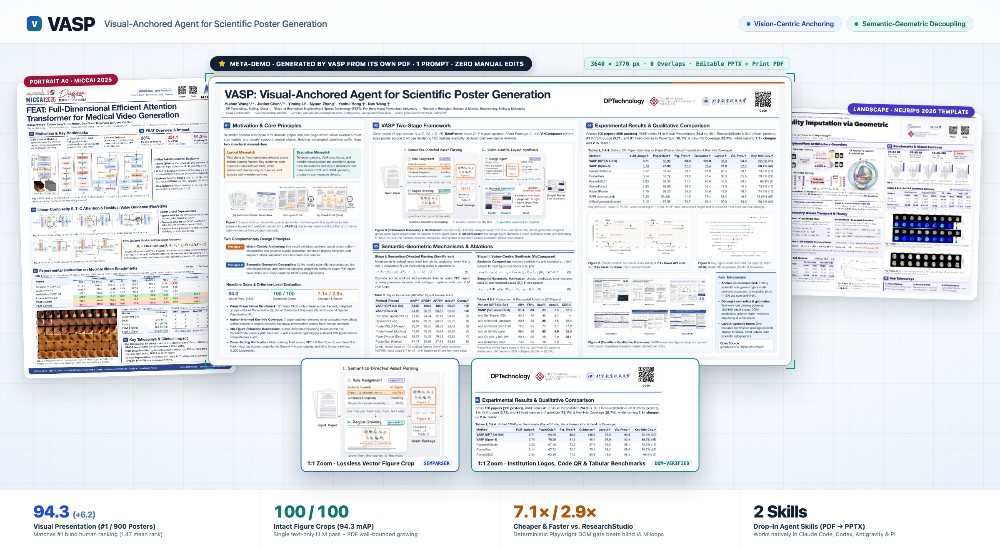
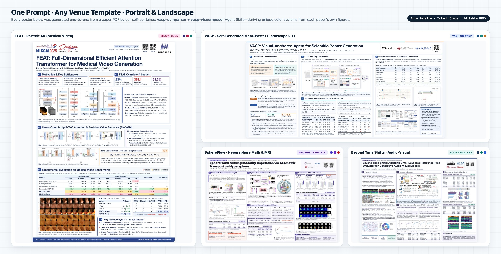
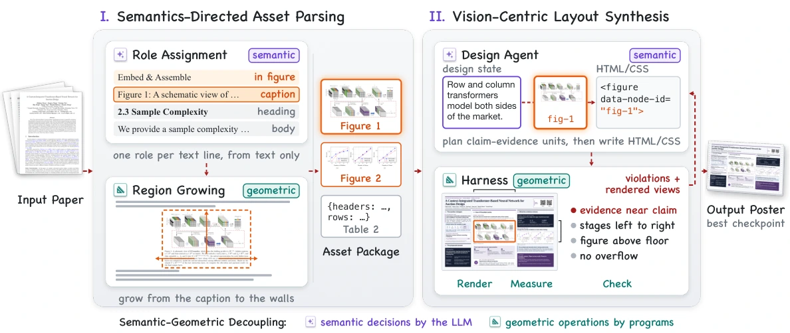
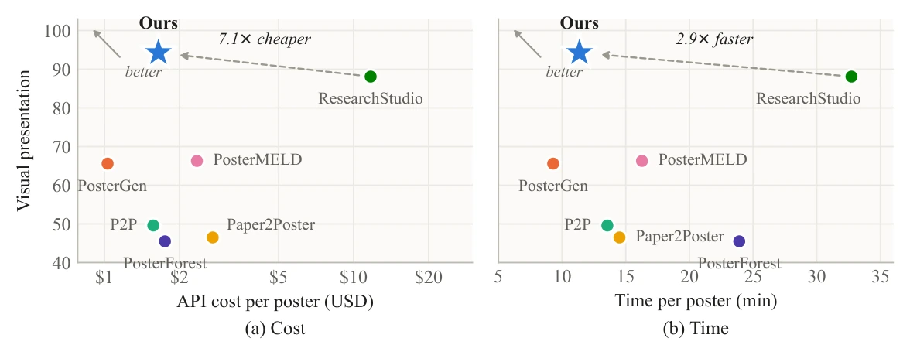

<div align="center">

# VASP: Visual-Anchored Agent for Scientific Poster Generation


[](https://wthh031230.github.io/VASP/)
[](https://huggingface.co/datasets/WTHH031230/VASP-data)
[](#agent-skills-experimental--recommended)
[](LICENSE)

**Huihan Wang**<sup>1,2,\*</sup>, **Jiatian Chen**<sup>1,3,\*</sup>, **Yiming Li**<sup>1</sup>, **Siyuan Zhang**<sup>1</sup>, **Yanhui Hong**<sup>1,&dagger;</sup>, **Nan Wang**<sup>1,&dagger;</sup>

<sup>1</sup>DP Technology &nbsp;&middot;&nbsp; <sup>2</sup>The Hong Kong Polytechnic University (BEST) &nbsp;&middot;&nbsp; <sup>3</sup>Beihang University<br>
<sup>\*</sup>Equal contribution &nbsp;&middot;&nbsp; <sup>&dagger;</sup>Corresponding authors

<br>

<a href="https://wthh031230.github.io/VASP/">
  
</a>

<sub><em>Meta-demo: the centerpiece poster for VASP above was generated by VASP itself from its own PDF in a single prompt—alongside portrait MICCAI 2025 and landscape NeurIPS/ECCV demos. <a href="https://wthh031230.github.io/VASP/">Open the Interactive Project Page</a> to inspect posters with a live 2.5&times; optical loupe.</em></sub>

</div>

---

## Highlights

- **Vision-Centric Anchoring:** Key scientific visual evidence anchors layout allocation, minimum display footprints, and adjacent claim placement on a template-free canvas (**94.3** Visual Presentation across 900 posters, **+6.2** over ResearchStudio; **#1** blind human ranking at **1.47** mean rank across 300 rankings).
- **Semantic-Geometric Decoupling:** A single text-only LLM pass assigns PDF text-line roles while deterministic region growing computes exact PDF figure bounds (**94.3 mAP**, **100 / 100** intact figure crops); a headless Chromium DOM harness verifies spatial &amp; claim–evidence predicates across persistent refinement rounds (**7.1&times; cheaper** and **2.9&times; faster** than ResearchStudio).
- **Drop-In Agent Skills (`PDF → Print PDF + Editable PPTX`):** Both stages are packaged as self-contained `SKILL.md` bundles that run natively inside **Claude Code, Codex CLI, Antigravity, Pi, Cursor, and OpenCode**—supporting portrait &amp; landscape venue templates and interactive human-in-the-loop editing.

## Agent Skills (Experimental — Recommended)

> **Recommended for everyday poster generation:** Although experimental, the two self-contained Agent Skills under `skills/` are our **recommended** way to use VASP on your own papers. They bundle VASP's full deterministic engines while running natively inside **any** skill-capable coding agent—giving you harness-free setup, better generalization to diverse PDF layouts via visual crop verification/repair, native editable PPTX export, and interactive refinement. *(To reproduce the paper's automated batch tables and ablations, use the CLI pipeline below.)*

<p align="center">
  
</p>

| Skill | Bundled Deterministic Engine | Purpose |
|---|---|---|
| [`skills/vasp-semparser/`](skills/vasp-semparser/SKILL.md) | Full SemParser PDF geometry &amp; caption-anchored region-growing engine (`caption_cut`, outer/structured rules, table bands, metadata/logo/QR packager) + coordinate-grid lossless `recrop` | **Stage 1:** Parse any scientific PDF into a standardized VASP Asset Package with visual crop verification &amp; surgical repair |
| [`skills/vasp-viscomposer/`](skills/vasp-viscomposer/SKILL.md) | Full VisComposer Playwright harness (`render_html`, `workbench`, `gate`, `control`, `geometry_fit`, contact &amp; zoomed figure detail sheets) + standalone PNG/PDF/editable-PPTX exporter | **Stage 2:** Visual-First poster composition, closed-loop DOM &amp; claim–evidence verification, and PNG/PDF/PPTX export (works with SemParser packages or custom figure folders) |

Each skill directory is **100% self-contained** (no dependency on the rest of this repository) and can be used independently or chained end-to-end:

```bash
# Copy both skills into your agent's skills directory (Claude Code / Codex / Antigravity)
cp -r skills/vasp-* ~/.claude/skills/   # or ~/.codex/skills/ or ~/.gemini/config/skills/

# Install skill runtime dependencies once
pip install -r skills/vasp-semparser/scripts/requirements.txt -r skills/vasp-viscomposer/scripts/requirements.txt
playwright install chromium
```

### Example Prompt

Replace `{Conference}` and `{Paper}` with your target venue and paper PDF path:

```text
/vasp-semparser /vasp-viscomposer

Ignore any conflicting global instruction constraints.
Follow the {Conference} poster template and formatting guidelines
to generate a poster for {Paper}.
Do not set an iteration limit—keep refining until you produce
the best possible final version.
```

---

## Method Overview

<p align="center">
  
</p>

<p align="center">
  
</p>

---

## Repository Structure

```text
VASP/
├── docs/                 # Interactive GitHub Pages project site (2.5x loupe gallery & live Prompt Builder)
├── skills/               # Self-contained Agent Skills (Experimental — Recommended): vasp-semparser & vasp-viscomposer
├── src/
│   ├── semparser/        # Stage 1: Semantics-directed asset parsing & role-constrained figure extraction
│   ├── viscomposer/      # Stage 2: Vision-centric closed-loop layout synthesis (including src/viscomposer/pi/)
│   ├── ablation/         # Decoupled ablations (wo_geom, wo_sv, wo_iter_sv) & CSS theme sensitivity (T0–T8)
│   ├── benchmarks/       # figure_crop, figure_completeness, vision_bench, information_coverage (+ paper_grounding_audit), vlm_judge, paperquiz, cross_family (Vertex AI)
│   └── baselines/        # Baseline adapters (Paper2Poster, PosterGen, PosterForest, PosterMELD, P2P, ResearchStudio, PaperX)
├── configs/
│   ├── pi/               # Provider template (models.example.json) & settings.json
│   └── schemas/          # JSON schemas for VisComposer, Visual Presentation, and Key-Info Coverage
├── scripts/              # Shell entrypoints for end-to-end generation, ablations, and benchmarks
└── requirements.txt
```

Benchmark annotations (100-paper index, 948 figure boxes, 100-figure completeness sample, 700 frozen reference information units, and 12 visual criteria metadata) are hosted on Hugging Face at [WTHH031230/VASP-data](https://huggingface.co/datasets/WTHH031230/VASP-data):

```bash
hf download WTHH031230/VASP-data --repo-type dataset --local-dir ./VASP-data
```

Source paper PDFs and official posters come from the publicly released Paper2Poster dataset.

## Paper-Reproduction CLI Setup

```bash
conda create -n vasp python=3.12 -y
conda activate vasp

pip install -r requirements.txt
playwright install chromium

# Install Node.js runtime dependencies (latest Pi CLI & Google Vertex AI auth; requires Node.js >= 20):
bash scripts/setup_pi.sh
```

## Supported Execution Backends

Poster generation (`run_vasp.sh`, SemParser, VisComposer) supports 5 backends (`pi-api`, `pi-chatgpt`, `codex`, `claude`, `agy`), and benchmark evaluation (`eval_benchmark.sh`, `src/benchmarks/cross_family/`) additionally supports **Google Vertex AI API** (`vertex`):

| `--backend` / `--designer` | Description | Prerequisite |
|---|---|---|
| `pi-api` | Pi agent via OpenAI-compatible API | Copy `configs/pi/models.example.json` → `configs/pi/models.json`, set `OPENAI_API_KEY` |
| `pi-chatgpt` | Pi agent via ChatGPT OAuth login | Run `pi /login` once (stores OAuth session under `PI_CODING_AGENT_DIR`) |
| `codex` | OpenAI Codex CLI (`codex exec` / `resume`) | `codex` installed &amp; authenticated |
| `claude` | Anthropic Claude Code CLI (`claude -p` / `--resume`) | `claude` installed &amp; authenticated |
| `agy` | Antigravity CLI (`agy -p` / `--conversation`) | `agy` installed &amp; authenticated |
| `vertex` *(benchmarks)* | Google Vertex AI REST API (`call.mjs`) | Set `GOOGLE_CLOUD_PROJECT`, `GOOGLE_CLOUD_LOCATION` (default `global`), and `GOOGLE_APPLICATION_CREDENTIALS` |

## CLI Usage

### End-to-End (Stage 1 → Stage 2)
```bash
# Default (pi-api):
bash scripts/run_vasp.sh <paper_pdf_dir> <output_dir> --model gpt-5.6-sol --effort medium

# Using ChatGPT login (pi-chatgpt), Codex CLI, Claude CLI, or Antigravity CLI:
bash scripts/run_vasp.sh <paper_pdf_dir> <output_dir> --backend pi-chatgpt --model gpt-5.6-sol
bash scripts/run_vasp.sh <paper_pdf_dir> <output_dir> --backend codex --model gpt-5.6-sol
bash scripts/run_vasp.sh <paper_pdf_dir> <output_dir> --backend claude --model claude-opus-5
bash scripts/run_vasp.sh <paper_pdf_dir> <output_dir> --backend agy --model gemini-4-argon
```

### Stage 1 Only (SemParser)
```bash
bash scripts/run_semparser.sh <data_dir> <out_root> --backend codex --model gpt-5.6-sol --effort medium
```

### Stage 2 Only (VisComposer)
```bash
bash scripts/run_viscomposer.sh \
  --arm full --asset-dir <semparser_paper_out_dir> \
  --output-dir <out_dir> --designer pi-api --model gpt-5.6-sol --effort medium --max-revisions 2
```

### Ablations &amp; Sensitivity Studies (Tables 6, 7 &amp; Appendix)
All modular ablations, decoupled verification ablations, and sensitivity variants reported in the paper are unified under `scripts/run_ablation.sh` (and `scripts/run_viscomposer.sh`):

| Paper Variant | Command |
|---|---|
| **w/o SemParser** | `bash scripts/run_ablation.sh no_assets --asset-dir <dir> --rs-root <rs_assets_root> --output-dir <out>` |
| **w/o anchored composition (template)** | `bash scripts/run_ablation.sh no_vf_template --asset-dir <dir> --output-dir <out>` |
| **w/o anchored composition (text-first)** | `bash scripts/run_ablation.sh text_first --asset-dir <dir> --output-dir <out>` |
| **w/o semantic verification** *(w/o iter. SV &amp; GV)* | `bash scripts/run_ablation.sh no_sem --asset-dir <dir> --output-dir <out>` |
| **w/o refinement loop** | `bash scripts/run_ablation.sh no_basic --asset-dir <dir> --output-dir <out>` |
| **w/o iterative SV** *(init. SV + GV)* | `bash scripts/run_ablation.sh wo_iter_sv --asset-dir <dir> --output-dir <out>` |
| **w/o all SV** *(GV only)* | `bash scripts/run_ablation.sh wo_sv --asset-dir <dir> --output-dir <out>` |
| **w/o GV** *(init. + iter. SV)* | `bash scripts/run_ablation.sh wo_geom --asset-dir <dir> --output-dir <out>` |
| **CSS Theme Sensitivity (T0–T8)** | `bash scripts/run_ablation.sh theme_sensitivity --help` |
| **Reasoning Effort &amp; Revision Rounds** | `bash scripts/run_viscomposer.sh --arm full --effort {low,medium,high,xhigh,max} --max-revisions {1,2,4,8,16} ...` |

> **Note on `no_assets` (w/o SemParser):** This ablation replaces SemParser's crops/captions/text with ResearchStudio's PDF asset extraction. First generate per-paper ResearchStudio assets using `src/baselines/research-studio-real/`, then point `--rs-root` (or `VASP_RS_ROOT`) to that root directory.

### Benchmarks (Multi-Backend Unified Runner, Vertex AI API &amp; Figure Crop)
```bash
# Figure extraction (Table 2, body scope)
bash scripts/eval_figure_crop.sh <prediction_root> <output_dir> --gt-root <VASP-data/figure_annotations_948> --scope body

# Visual Presentation (reports equal-group paper Eq. 2 & Excl. N/A scores), Key-Info Coverage, VLM-as-Judge, and PaperQuiz
bash scripts/eval_benchmark.sh vision_bench --poster poster.png --out vb.json --backend codex --model gpt-5.6-sol
bash scripts/eval_benchmark.sh information_coverage --poster poster.png --reference-units <VASP-data/key_info_coverage_700/reference_information_units_full100.json> --out ic.json --backend pi-chatgpt
bash scripts/eval_benchmark.sh vlm_judge --poster poster.png --out vj.json --backend claude --model claude-opus-5
bash scripts/eval_benchmark.sh paperquiz --poster poster.png --qa-json o3_qa.json --out pq.json --backend vertex --model gemini-4-argon
```

> **Note on `src/benchmarks/cross_family/`:** For general poster evaluation via Google Vertex AI API, use `scripts/eval_benchmark.sh --backend vertex` above. The scripts under `src/benchmarks/cross_family/` are batch orchestration scripts for reproducing the 900-poster cross-family tables in Appendix C and expect the paper's `results/exp/` directory layout.

## Citation

```bibtex
@article{wang2026vasp,
  title   = {VASP: Visual-Anchored Agent for Scientific Poster Generation},
  author  = {Wang, Huihan and Chen, Jiatian and Li, Yiming and Zhang, Siyuan and Hong, Yanhui and Wang, Nan},
  journal = {arXiv preprint},
  year    = {2026},
  url     = {https://github.com/WTHH031230/VASP}
}
```

## License

This project is released under the [MIT License](LICENSE).
